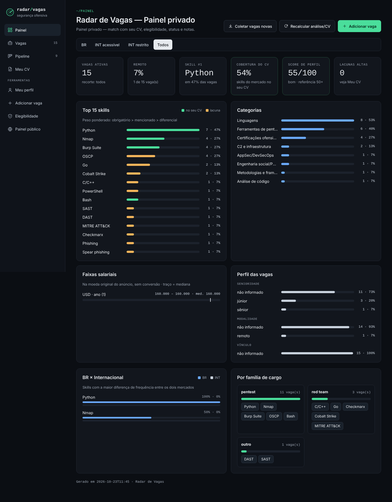
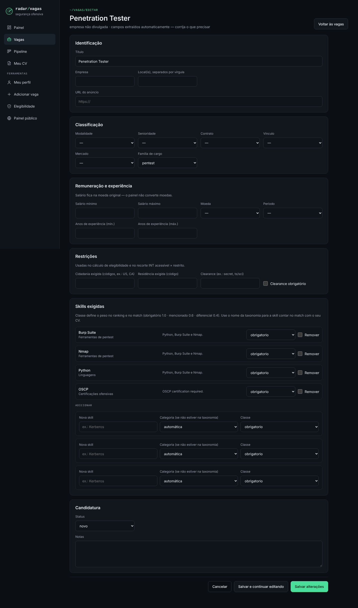
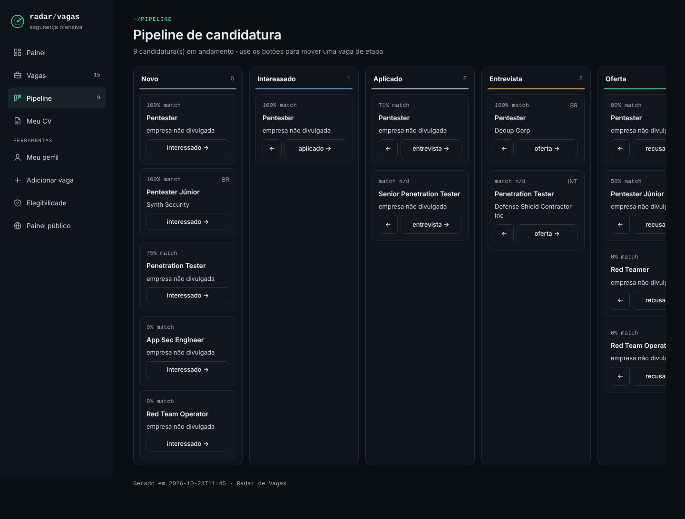

# Radar de Vagas

Radar pessoal de vagas de **Red Team, Pentest e Segurança Ofensiva** no mercado privado, no Brasil e no exterior. Ele coleta e limpa os anúncios, mostra quais skills o mercado mais pede, compara essas skills com o seu currículo e acompanha as suas candidaturas. Tudo roda localmente, num banco SQLite.



> As capturas usam vagas sintéticas das fixtures de teste.

---

## Sumário

- [O que ele faz](#o-que-ele-faz)
- [Instalação](#instalação)
- [Começo rápido](#começo-rápido)
- [A app web](#a-app-web)
- [Linha de comando](#linha-de-comando)
- [Colocando vagas no radar](#colocando-vagas-no-radar)
- [Configuração (`data/`)](#configuração-data)
- [CV, match e elegibilidade](#cv-match-e-elegibilidade)
- [Meu perfil e score](#meu-perfil-e-score)
- [IA opcional](#ia-opcional)
- [Publicando no GitHub Pages](#publicando-no-github-pages)
- [Privacidade e segurança](#privacidade-e-segurança)
- [Arquitetura](#arquitetura)
- [Testes](#testes)

---

## O que ele faz

| Área | Recursos |
|---|---|
| **Coleta** | Colar o texto de uma vaga (CLI ou navegador), dividir e-mails de alerta com várias vagas, coleta automática pelas APIs públicas de Greenhouse, Lever, Ashby e SmartRecruiters |
| **Processamento** | Limpeza (mojibake, HTML, ruído de ATS, palavras coladas). Extração de título, empresa, local, modalidade, senioridade, contrato, vínculo, família de cargo, salário, anos de experiência e restrições (cidadania, residência, clearance). Detecção de skills por taxonomia editável, com grupos "um destes" |
| **Qualidade** | Deduplicação por URL ou conteúdo. Vagas de órgão público ficam fora das estatísticas. Vagas que saem da fonte são arquivadas automaticamente |
| **Análise de mercado** | Ranking de skills e categorias. Comparação BR × Internacional e por família de cargo. Faixas salariais na moeda original. Recortes BR / INT acessível / INT restrito / todos |
| **Seu CV** | % de match por vaga, lacunas priorizadas, plano de estudo por categoria, evolução da cobertura ao longo do tempo |
| **Elegibilidade** | `sim` / `não` / `talvez` por vaga, com o motivo, a partir do seu perfil (cidadania, residência, clearance, relocação) |
| **Candidaturas** | Pipeline `novo → interessado → aplicado → entrevista → oferta / recusado` (mais `arquivada`), com notas por vaga |
| **Meu perfil** | Perfil no estilo LinkedIn (importado do PDF ou editado à mão), score de 0 a 100, melhorias sugeridas e exportação do perfil revisado em PDF |
| **Painéis** | App web local com edição completa e snapshot estático só de leitura para o GitHub Pages. Tema claro/escuro automático e layout responsivo |

## Instalação

Requer **Python 3.10+**. O núcleo usa só a biblioteca padrão. Os extras são opcionais:

```bash
git clone https://github.com/ViniciusClement/jobs.git
cd jobs

pip install flask        # app web (python run.py serve)
pip install pypdf        # opcional: ler CV em PDF
pip install weasyprint   # opcional: exportar o perfil revisado em PDF
```

Não é preciso instalar um servidor de banco: o SQLite é um único arquivo (`data/radar.db`), criado no primeiro uso.

<details>
<summary>Windows</summary>

1. Instale o [Python](https://www.python.org/downloads/) marcando **"Add python.exe to PATH"**.
2. Clone ou baixe o repositório, por exemplo em `C:\Users\você\jobs`.
3. Abra o PowerShell nessa pasta e rode os comandos `pip` acima.

</details>

## Começo rápido

```bash
# 1. Coloque seu CV em cv/ (PDF, DOCX, TXT ou MD)
# 2. Suba a app
python run.py serve
# 3. Abra http://localhost:8000/privado
```

Na app, use **Adicionar vaga** para colar o primeiro anúncio, ajuste a **Elegibilidade** e clique em **Recalcular análise/CV**.

## A app web

`python run.py serve [--port 8000]` liga a app apenas em `127.0.0.1`. O menu lateral leva a todas as áreas:

| Página | Endereço | O que tem |
|---|---|---|
| **Painel** | `/privado#painel` | Recortes de mercado, indicadores, top skills (verde = no seu CV, âmbar = lacuna), categorias, faixas salariais, perfil das vagas, BR × INT e famílias de cargo. Botões **Coletar vagas novas** e **Recalcular análise/CV** |
| **Vagas** | `/privado#vagas` | Busca por título, empresa ou skill. Filtros por senioridade, modalidade, contrato, vínculo, família, skill, restrição, status e "só elegíveis". Visualização em cards ou tabela, com ordenação |
| **Editar vaga** | `/privado/vaga/<id>/editar` | Todos os campos da vaga (veja abaixo) |
| **Pipeline** | `/privado#pipeline` | Colunas por etapa. Os botões ← / → mudam o status sem apagar as notas |
| **Meu CV** | `/privado#meu-cv` | Lacunas priorizadas, plano de estudo por categoria e evolução da cobertura |
| **Meu perfil** | `/perfil-profissional` | Perfil profissional, score, sugestões, melhorias no currículo, importação do LinkedIn e exportação em PDF |
| **Editar perfil** | `/perfil-profissional/editar` | Nome, headline, local, resumo, experiências, formação, certificações, skills e idiomas |
| **Adicionar vaga** | `/adicionar` | Colar uma ou várias vagas |
| **Elegibilidade** | `/perfil` | Cidadanias, residência, clearances, relocação e idiomas |
| **Painel público** | `/` | A mesma visão de mercado, sem nenhum dado pessoal |

### Editando uma vaga

Tudo o que o parser extraiu pode ser corrigido:

- **Identificação:** título, empresa, locais e URL.
- **Classificação:** modalidade, senioridade, contrato, vínculo, mercado (BR/INT) e família de cargo.
- **Remuneração:** salário mínimo e máximo, moeda e período (sem conversão de moeda), além dos anos de experiência.
- **Restrições:** cidadania exigida, residência e clearance (obrigatório ou diferencial). Elas alimentam a elegibilidade e o recorte INT.
- **Skills:**
  - mudar a classe de uma skill (`obrigatorio` 1.0 · `mencionado` 0.6 · `diferencial` 0.4), o que muda o peso no ranking e no match;
  - remover uma skill;
  - adicionar uma skill nova, com autocompletar da taxonomia: o nome é corrigido para o nome canônico e a categoria é preenchida sozinha.
- **Candidatura:** status e notas.





## Linha de comando

Tudo o que a app faz também pode ser feito pela CLI, e as duas gravam no mesmo banco:

| Comando | O que faz |
|---|---|
| `python run.py paste` | Lê a área de transferência, salva na inbox e processa |
| `python run.py split arquivo.txt [--dry-run]` | Divide um texto com várias vagas (ex.: e-mail de alerta) e mostra uma prévia dos cortes |
| `python run.py collect [--dry-run]` | Coleta pelas APIs configuradas em `data/fontes.json` e grava na inbox |
| `python run.py process` | Processa a inbox e salva no banco (é o padrão quando não se passa subcomando) |
| `python run.py reprocess` | Reaplica as regras de `data/` a todas as vagas, preservando status e notas |
| `python run.py analyze [--cv caminho]` | Lê o CV, calcula elegibilidade, cobertura e lacunas, e gera `privado/relatorio-cv.md` |
| `python run.py status <id> <status> [--note "..."]` | Muda o status e as notas de uma vaga |
| `python run.py terms [--top 30]` | Lista termos frequentes fora da taxonomia (candidatos a skills novas) |
| `python run.py export` | Exporta `data/vagas.csv`, sem contatos nem texto bruto |
| `python run.py import-linkedin Profile.pdf` | Importa o perfil do LinkedIn ("Salvar como PDF") |
| `python run.py generate-html` | Gera o snapshot estático `docs/index.html` + `privado/index.html` |
| `python run.py serve [--port 8000]` | Sobe a app web local |
| `python run.py --ai` | Gera sugestões de CV por IA (opcional, ver abaixo) |

Rotina típica pela CLI (boa para agendar):

```bash
python run.py collect && python run.py process
python run.py analyze
python run.py generate-html
```

## Colocando vagas no radar

### Colando o texto

O cabeçalho é opcional:

```
Empresa: ... | Local: ... | URL: ... | Data: AAAA-MM-DD | Origem: linkedin|indeed|gupy|... | Mercado: BR|INT | Status: interessado
---
(texto da vaga, começando pelo título)
```

Para colar várias vagas de uma vez, separe-as com uma linha contendo exatamente `=== VAGA ===`. Se o texto tiver várias vagas sem separador (como um e-mail de alerta), use `python run.py split`.

### Coleta automática

O coletor usa só os endpoints JSON **públicos e oficiais** de quatro ATS, sem login e sem raspar HTML:

| ATS | Endpoint | Slug na URL de carreiras |
|---|---|---|
| Greenhouse | `boards-api.greenhouse.io/v1/boards/{slug}/jobs?content=true` | `boards.greenhouse.io/{slug}` |
| Lever | `api.lever.co/v0/postings/{slug}?mode=json` | `jobs.lever.co/{slug}` |
| Ashby | `api.ashbyhq.com/posting-api/job-board/{slug}` | `jobs.ashbyhq.com/{slug}` |
| SmartRecruiters | `api.smartrecruiters.com/v1/companies/{slug}/postings` | `careers.smartrecruiters.com/{slug}` |

Em `data/fontes.json`, troque cada `"slug": "TROCAR"` pelo slug real e ajuste `filtros.titulo_inclui` e `filtros.titulo_exclui`.

- Vagas já existentes são deduplicadas pela URL.
- Uma vaga que some da fonte vira `arquivada`, com a nota "encerrada na fonte". Isso só acontece se o status ainda for `novo` ou `interessado`: o que você já mudou à mão não é sobrescrito.
- O coletor usa User-Agent identificado, timeout de 15 s, pausa entre requisições, e o erro de uma fonte não derruba as outras.

**LinkedIn, Indeed e Gupy continuam manuais**: eles não têm API pública de uso livre, e automatizar a coleta violaria os termos de uso. Configure alertas por e-mail nessas plataformas e use `paste` ou `split`.

<details>
<summary>Agendando no Windows</summary>

No Agendador de Tarefas, crie uma ação "Iniciar um programa" com `cmd.exe` e os argumentos:

```
/c "cd /d C:\caminho\para\jobs && python run.py collect && python run.py process"
```

</details>

### Filtro de mercado privado

Vagas de **órgão público** (concurso, edital, autarquia, `.gov.br`...) são marcadas como `ignorada` e ficam fora das estatísticas e dos painéis. Elas não são apagadas. Uma empresa **privada** que presta serviço ao governo continua contando normalmente, só ganha a marcação `setor_cliente: "governo_contratada"`.

## Configuração (`data/`)

Os arquivos JSON de `data/` são configuração versionada. Depois de editar qualquer um deles, rode `python run.py reprocess`.

| Arquivo | Para que serve |
|---|---|
| `skills.json` | Taxonomia de skills por categoria |
| `secoes.json` | Cabeçalhos de seção reconhecidos (PT/EN): descrição, responsabilidades, requisitos, diferenciais, benefícios, sobre a empresa |
| `ruido.json` | Linhas e regex de ruído de interface e ATS a remover |
| `filtros.json` | Termos de setor público e de contratada de governo |
| `familias.json` | Palavras-chave de título para a família de cargo (`red_team`, `pentest`, `appsec`, `gestao_vuln`; o resto vira `outro`) |
| `fontes.json` | Fontes e filtros do coletor automático |

### Taxonomia de skills

```json
{
  "Categoria": {
    "Nome da skill": {
      "sinonimos": ["variante 1", "variante 2"],
      "regex": ["padrão opcional"],
      "case_sensitive": false
    }
  }
}
```

- Os `sinonimos` nunca diferenciam maiúsculas de minúsculas.
- O `regex` respeita `case_sensitive`, o que ajuda com siglas ambíguas (`Go`, `AWS`, `C/C++`...).
- Frases como "one or more of", "ou equivalente" e "e/ou" agrupam as skills da linha num **grupo alternativo**. No match, o grupo conta como uma única exigência, e qualquer membro dele satisfaz.

A taxonomia já vem com estas categorias: Active Directory, Cloud/Identidade, Web/API, AppSec/DevSecOps, Ferramentas de pentest, Gestão de vulnerabilidades, Análise de código, C2 e infraestrutura, Evasão, Engenharia social/Phishing/OSINT, Testes especializados, Malware dev, Metodologias e frameworks, Linguagens, Certificações ofensivas, Certificações gerais/gestão e Soft skills/relatórios.

## CV, match e elegibilidade

- **CV:** o arquivo mais recente em `cv/` (PDF, DOCX, TXT ou MD; versões antigas podem ir para `cv/arquivo/`). Se o texto extraído tiver menos de 500 caracteres (PDF escaneado, por exemplo), a cobertura não é calculada.
- **Match por vaga:** fração das exigências da vaga, ponderadas pela classe, que aparecem no seu CV.
- **Lacunas:** skills frequentes no mercado que não estão no seu CV, com prioridade alta, média ou baixa e agrupadas por categoria no plano de estudo.
- **Elegibilidade:** compara as restrições da vaga com o seu perfil (página **Elegibilidade** ou `privado/perfil.json` no primeiro uso):

```json
{
  "cidadanias": ["BR"],
  "residencia": "BR",
  "clearances": [],
  "aceita_relocacao": false,
  "idiomas": {"pt": "nativo", "en": "intermediario"}
}
```

## Meu perfil e score

- **Importação:** no LinkedIn, abra seu perfil → **Mais** → **Salvar como PDF**. Depois importe o arquivo na página ou use `python run.py import-linkedin`.
- **Edição:** o botão **Editar perfil** permite preencher ou corrigir tudo à mão, inclusive sem importar nada.
- **Score de 0 a 100:**
  - 55% vem da cobertura de hard skills do mercado;
  - 20% vem das soft skills (categoria "Soft skills/relatórios");
  - 25% vem da completude do perfil (headline, resumo, experiências, formação, skills e certificações).
  
  Seguindo a referência do SSI do LinkedIn, **50 ou mais é bom**.
- **Exportar PDF revisado:** gera um PDF com o perfil, o score e as melhorias sugeridas. Requer `weasyprint`.

## IA opcional

`python run.py --ai` gera sugestões de reescrita do CV em `privado/sugestoes-cv.md`. Vem **desligado por padrão**: sem as variáveis de ambiente abaixo, o comando só avisa que não há IA configurada.

| Backend | Variáveis | Observação |
|---|---|---|
| Claude API | `ANTHROPIC_API_KEY`, `ANTHROPIC_MODEL` | Trechos do CV, sem e-mail nem telefone, são enviados à API |
| Ollama local | `OLLAMA_URL`, `OLLAMA_MODEL` | Nada sai da sua máquina |

O prompt nunca leva o texto bruto das vagas nem contatos. A IA é instruída a não inventar experiência e a não sugerir formas de contornar exigências de cidadania, residência ou clearance. **Revise sempre o resultado antes de usar.**

## Publicando no GitHub Pages

`python run.py generate-html` gera:

- `docs/index.html`: painel **público**, que pode ir para o GitHub Pages;
- `privado/index.html`: painel **privado**, que está no `.gitignore`.

Os dois são só leitura, com CSS, JS e dados embutidos no próprio arquivo, e não carregam nada de fora. Aponte o GitHub Pages para a pasta `docs/`.

O painel público nunca contém texto bruto de vaga, e-mail ou telefone, status, notas, dados do perfil nem trechos do CV. O `tests/test_html.py` verifica isso automaticamente. O recorte INT acessível/restrito do público usa um perfil genérico fixo (BR, sem relocação), nunca o seu.

## Privacidade e segurança

**O que nunca vai para o git** (está no `.gitignore`):

- `data/radar.db*`, que guarda o texto completo das vagas, contatos de recrutadores e o seu perfil;
- `privado/`, `vagas/` e `cv/*` (exceto `cv/README.md`);
- `tests/fixtures_reais/` e `.env`.

Versionar anúncios de terceiros e contatos de recrutadores seria redistribuir conteúdo e dados pessoais sem consentimento.

**Medidas de segurança no código:**

- **SQL:** `radar/db.py` é o único módulo que monta SQL, e todas as queries usam parâmetros.
- **XSS:**
  - as páginas do servidor escapam todo valor dinâmico (`html.escape`, inclusive em atributos);
  - o painel monta o HTML via DOM (`textContent`);
  - os campos de seleção dos formulários só aceitam valores das listas fechadas;
  - há testes de regressão com valores maliciosos.
- **CSRF (mitigação leve):** POSTs cuja `Origin`/`Referer` não seja o próprio host recebem 403. Não há token por formulário, o que é suficiente para uma ferramenta pessoal local.
- **Rede:** a app só escuta em `127.0.0.1` e roda com `debug=False`. O coletor só acessa os quatro endpoints documentados, com timeout.
- **Segredos:** a `ANTHROPIC_API_KEY` só é lida de variável de ambiente, nunca é logada nem gravada.
- **Comandos externos:** o único `subprocess` (o fallback de clipboard no Windows) usa uma lista fixa de argumentos, sem `shell=True`.
- **Mascaramento:** e-mails e telefones são mascarados nas evidências de skill exibidas nos painéis.

## Arquitetura

```
run.py               CLI, orquestração e montagem dos payloads dos painéis
radar/
  limpeza.py         normalização do texto bruto
  parser.py          cabeçalho, seções, campos, restrições, salário, datas
  skills.py          matcher de skills (taxonomia + grupos alternativos)
  cv.py              leitura do CV e detecção de skills nele
  coletor.py         clientes dos 4 ATS (endpoints JSON públicos)
  analise.py         mercado, cobertura, lacunas, elegibilidade, score (sem I/O)
  linkedin_import.py parser do PDF do LinkedIn
  db.py              camada SQLite (único lugar com SQL)
  estilo.py          sistema visual compartilhado (tema, componentes, menu)
  html.py            template único dos painéis (snapshot e app)
  web.py             rotas Flask: só HTTP e HTML, sem lógica de negócio
  ia.py              sugestões de CV via Claude API ou Ollama (opcional)
data/                radar.db (local) + configuração JSON versionada
cv/ vagas/ privado/  CV, inbox da CLI e saídas privadas (fora do git)
docs/                snapshot público para o GitHub Pages
```

Toda entrada (paste, split, collect ou o formulário da web) passa por `parser.montar_vaga()` e termina em `data/radar.db`. O snapshot estático e a app web usam as **mesmas** funções (`montar_payload_publico` / `montar_payload_privado`) e o mesmo template, então não existem duas versões do painel. Cada rota de `web.py` chama funções já testadas de `run.py`, de modo que a CLI e o navegador nunca divergem.

Quem tinha `data/vagas.json` ou `privado/perfil.json` de uma versão anterior não precisa fazer nada: esses arquivos são importados para o banco automaticamente na primeira leitura.

## Testes

```bash
python -m unittest -v     # ou: python -m pytest -q
```

- Os testes da app web são pulados se o Flask não estiver instalado.
- Os testes de HTML abrem as páginas num Chromium headless via Selenium, se houver um disponível. Caso contrário, pulam essa parte.
- Anúncios reais colocados em `tests/fixtures_reais/` (pasta ignorada pelo git) são testados sem risco de ir para o repositório.
- O teste `test_cv … exemplo` espera um `cv/exemplo.md` (CV fictício) local. Sem esse arquivo, ele falha.
